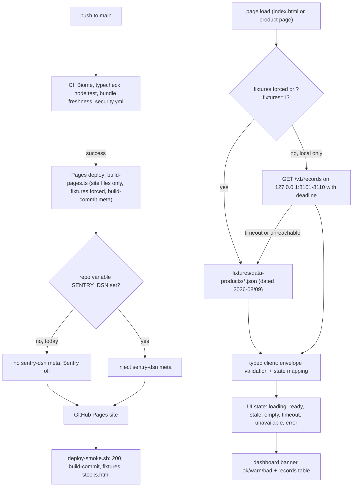
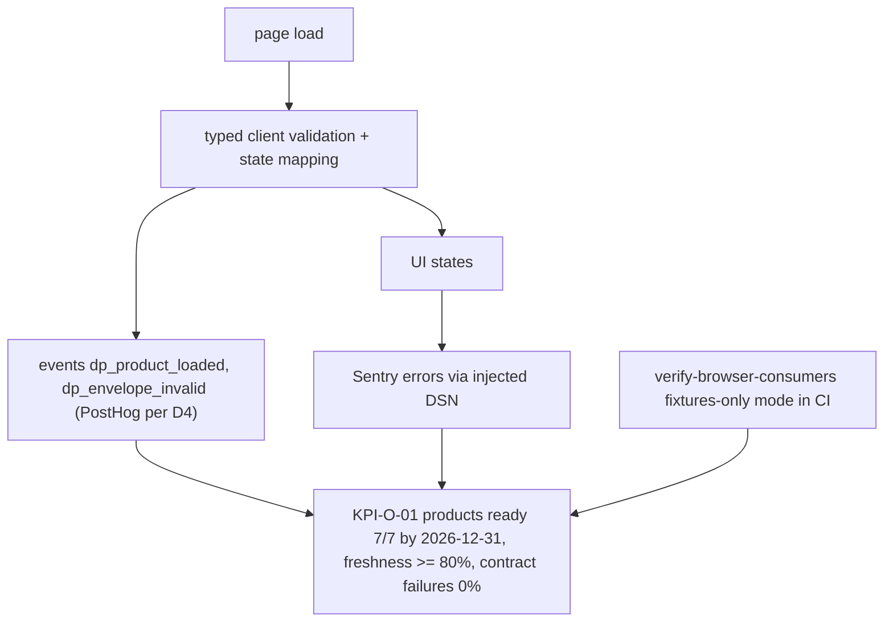

# 01 — Business process (As-Is / To-Be)

market-insights-web (Solo Empire Insights) คือเว็บ static หลายหน้าที่อ่าน data-product API แบบอ่านอย่างเดียว 7 ตัว (crypto, stocks, FX, DeFi, SEO, news, discovery) แล้วแสดงสถานะและรายการ ใช้โดย owner เป็นตัวตรวจ contract ฝั่งผู้อ่าน และเป็น demo บน GitHub Pages ที่แสดง fixtures เท่านั้น

Last reviewed: 2026-11-28 · commit `29ef204`

## As-Is (จากโค้ดวันนี้)

Sources: `src/data-products/client.ts`, `src/data-products/catalog.ts`, `src/data-products/request.ts`, `js/data-products-browser.js`, `src/monitoring/browser.ts`, `scripts/build-pages.ts`, `scripts/deploy-smoke.sh`, `.github/workflows/ci.yml`, `.github/workflows/pages.yml`, `PRODUCT.md`

ข้อเท็จจริงจากโค้ดและเอกสาร:

- ผู้เข้าชมสาธารณะเห็น fixtures เสมอ เพราะ build บังคับ `window.DATA_PRODUCTS_USE_FIXTURES = true`; ไม่มี hosted API
- อ่านอย่างเดียว: ไม่มี refresh ไม่มี write; Jobs (`job.v1`, :8109) ไม่อยู่ใน UI สาธารณะนี้
- README ยังอ้าง `NEXT_PUBLIC_*` ทั้งที่หน้า static อ่าน `window.DATA_PRODUCT_URLS` (`PRODUCT.md`)

## To-Be (`docs/measurement/KPI-PLAN.md` approved 2026-10-24, `docs/UPGRADE-PLAN.md` §Backlog)

Sources: `docs/measurement/KPI-PLAN.md`, `docs/UPGRADE-PLAN.md`

## Gap

| ID | As-Is → To-Be | Status | Owner | Evidence |
|---|---|---|---|---|
| G1 | repo variable `SENTRY_DSN` ไม่ได้ตั้ง Sentry ไม่รายงาน → DSN ถูก inject เพื่อวัด KPI-G-01 | decide | owner | `PRODUCT.md` §Error reporting; `.github/workflows/pages.yml` |
| G2 | ไม่มี analytics → events `dp_product_loaded`, `dp_envelope_invalid` ผ่าน PostHog (D4) | blocked | owner | `docs/measurement/KPI-PLAN.md` (ไม่มี account หรือ key) |
| G3 | ไม่มี baseline KPI → KPI-O-01 7/7 products ready ภายใน 2026-12-31 บน local stack | todo | claude | `docs/measurement/KPI-PLAN.md` KPI definitions ("not yet measured") |
| G4 | `verify-browser-consumers.mjs` ต้องมี API ทุกตัว และ CI แค่ `node --check` → มีโหมด fixtures-only ที่รันใน CI | todo | claude | `docs/UPGRADE-PLAN.md` P2; `.github/workflows/ci.yml` |
| G5 | ตารางสินค้าไม่มี focusable wrapper และไม่มี reduced-motion styles → ผ่าน accessibility pass | todo | claude | `docs/UPGRADE-PLAN.md` P2; ไม่พบ `prefers-reduced-motion` ใน `css/insights.css` |
| G6 | ไม่มี demo สาธารณะ → deploy fixture mode เป็น static demo บน GitHub Pages (product card §8 ข้อ 1) | done | owner | `PRODUCT.md` §Live URL (D-MIW-1, 2026-10-24); `.github/workflows/pages.yml` |
| G7 | README อ้าง `NEXT_PUBLIC_*` → เอกสารตรงกับ `window.DATA_PRODUCT_URLS` | todo | claude | `PRODUCT.md` §What does not work |

## Open questions

- ต้องการ hosted data ให้ผู้เข้าชมเห็นข้อมูลจริงหรือไม่ (ตอนนี้ไม่มีเอกสาร To-Be เรื่องนี้)
- `TRUTH-PASS.md` ตรงกับ 7 product ปัจจุบันหรือไม่ (`DOCPACK/00-product-card.md` §8 ยังพูดถึง 9) [ต้องยืนยัน]
